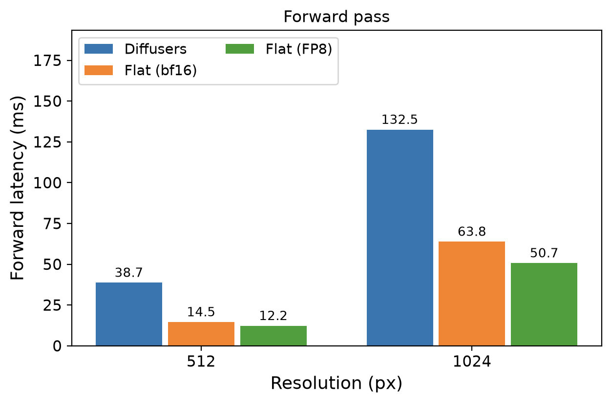
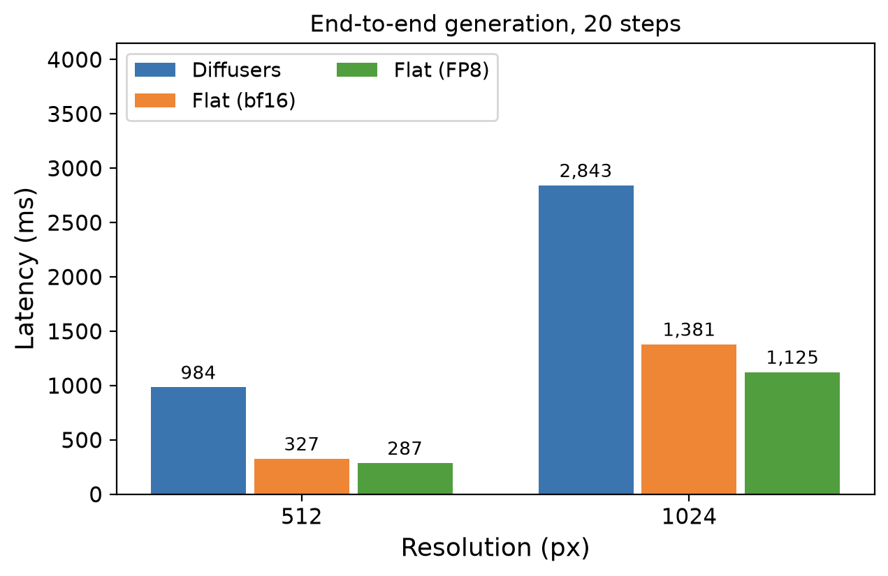
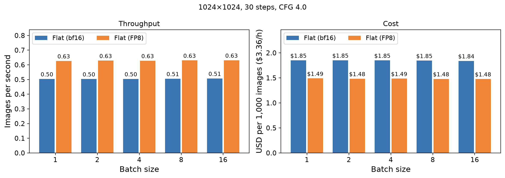
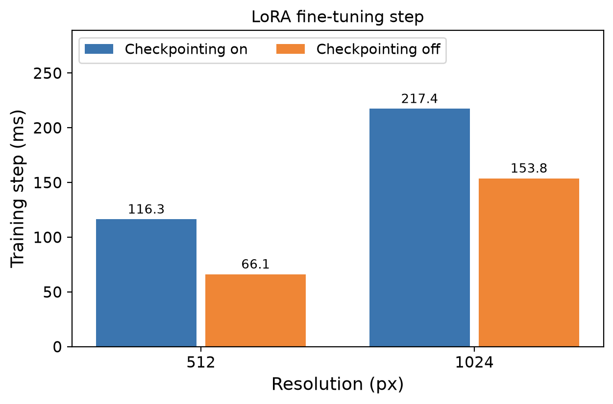

# anima-flat

Anima-flat is a variant of [Anima](https://huggingface.co/circlestone-labs/Anima), an
image generation model based on NVIDIA Cosmos-Predict2-2B-Text2Image developed jointly by CircleStone Labs and Comfy Org.

This project uses a flattened model-weight representation, specialized fused operations and optional FP8 matrix
multiplication to improve execution efficiency while retaining support for the original model architecture.

## Performance

Benchmarks were performed on a NVIDIA H200 NVL under an hourly rate of $3.36.

### Environment

| **Parameter** | **Value**        |
| :------------ | :--------------- |
| GPU           | NVIDIA H200 NVL  |
| PyTorch       | 2.14.1+cu130     |
| Python        | 3.12.15          |
| CUDA          | 13.0             |
| Precision     | BF16 and FP8     |
| Attention     | FlashAttention-4 |
| Kernels       | Triton & QuACK   |

### Forward Pass

One denoiser evaluation. At 1024×1024, Flat is 2.08x faster than Diffusers in BF16 and 2.61x faster with FP8.



### End-to-end inference

20 sampling steps, including text encoding and VAE decoding. At 1024×1024, Flat takes 1,381ms in BF16 and 1,125ms
with FP8, against 2,843ms for Diffusers.



### Single-image speed

At 1024×1024 with 20 sampling steps and batch size 1, Flat with FP8 generates an image in 1,125ms, including text
encoding and VAE decoding. That is about 0.89 images per second, or 53 images per minute, from a single request with
no batching. In BF16 it takes 1,381ms, or about 0.72 images per second. On the H200, batching from 1 to 16 provided essentially no throughput improvement at 1024×1024, indicating that this workload is already close to its practical throughput limit at batch size 1.

### Throughput

1024×1024, 30 sampling steps, CFG 4. Text encoding excluded aka cached conditioning.



FP8 generates 0.63 images per second, which is about $1.49 per 1,000 images. Throughput stays flat from batch size 1 to 16 (1,584 to 1,596ms per image), so batching saves nothing at this resolution. BF16 is flat too, at about 1,980ms per image, or 0.50 images per second and $1.85 per 1,000 images, so FP8 is 1.24x faster.

### Training

Rank-16 LoRA forward and backward execution. FP8 applies to inference only; training runs in BF16.



At 1024×1024, activation checkpointing needs 1.15 GiB of additional VRAM; turning it off is faster but needs 10.52 GiB.

Please note that results are specific to the tested parameters and workloads.
Performance comparisons should use equivalent configurations and settings.

## Samplers

Currently supported:

- Euler
- ER-SDE

Sampler selection affects both numerical behavior and visual output.
Different samplers may produce noticeably different results even with identical prompts, seeds and generation
settings.

## Gallery

Same prompt, seed and starting noise for every image. 1024×1024, 30 sampling steps, CFG 4. The stock Diffusers
pipeline uses its own scheduler, so its images differ from Flat by more than numerics.

<details>
<summary>Prompt</summary>

```
masterpiece, best quality, score_7, safe, highres, absurdres, 1boy, 1girl, aether, lumine, genshin_impact, siblings, twins, blonde hair, yellow eyes, hair flower, school uniform, white shirt, navy blazer, fully clothed, selfie, holding smartphone, outstretched arm, faces close together, looking at viewer, smile, peace sign, upper body, school rooftop, blue sky, golden hour sunlight, detailed eyes, detailed hair, detailed fabric, clean lineart, sharp focus, depth of field, soft lighting, vibrant colors
```

Negative:

```
worst quality, low quality, score_1, score_2, score_3, blurry, jpeg artifacts, sepia, nsfw, explicit, sensitive, nudity, bad anatomy, extra fingers, deformed hands, watermark, text
```

</details>

### Euler

|                 **Flat (BF16)**                 |                   **Flat (FP8)**                    |                    **Diffusers**                     |
| :---------------------------------------------: | :-------------------------------------------------: | :--------------------------------------------------: |
|  |  |  |

### ER-SDE

|                 **Flat (BF16)**                 |                   **Flat (FP8)**                    |                    **Diffusers**                     |
| :---------------------------------------------: | :-------------------------------------------------: | :--------------------------------------------------: |
|  |  |  |

The Diffusers image in the ER-SDE row is the same as in the Euler row, since the stock pipeline has its own sampler.

## FAQ

### Is the output identical to the original Anima?

Not bit for bit. Flat in BF16 matches the Diffusers implementation to about 1.4% relative error on the denoiser
output, and a 20-step test image reaches 26.7 dB PSNR against Diffusers. FP8 adds about 3% relative error on the
predicted velocity, which is visually equivalent on the images above but will change fine details. The ER-SDE sampler is a reimplementation and is not expected to match ComfyUI's pixel for pixel.

### Which GPUs does it run on?

It is developed and benchmarked on an H200. The Triton kernels run on other CUDA GPUs, and the FlashAttention-4 and
QuACK paths are used where available, with PyTorch fallbacks otherwise. FP8 needs a Hopper or newer GPU.

### Should I use FP8?

Yes, if your GPU supports it. It is about 1.19x faster per forward pass at 512×512 and 1.26x at 1024×1024, and about 1.23x
faster end-to-end at 1024×1024. FP8 is inference only.

### Euler or ER-SDE?

Empirically, Euler is the default and gives the classic anime look. ER-SDE gives a flatter, more neutral rendering. Both are
available in every script through `--sampler`.

### How do I generate an image?

```
python -m src.scripts.generate --prompt "your prompt" --fp8 --out out
```

Use `--sampler er_sde`, `--steps`, `--cfg`, `--seed`, `--lora` and the rest of the options listed by `--help`. `--compile-vae` makes decoding about 1.2x faster at the cost of a slower first image and a recompile for each new resolution; it pays off when generating many images at one size. Images
are named after their seed.

### How do I measure speed on my hardware?

```
python -m src.scripts.profile --fp8
python -m src.scripts.throughput --batches 1 2 4 --cache-text --fp8
```

`--price` sets the hourly GPU price used for the cost figures.

### Can I fine-tune with it?

Yes. LoRA training uses the same flattened weights; the timings are in the Training section above. Adapters can be
merged at load time with `--lora`.

### Can I upload weights to Hugging Face?

`python -m src.scripts.export` validates the files and uploads them in one commit. `--license-from` copies the
upstream model's license and attribution notice into the repo.

### Does it work in ComfyUI?

Not yet.

### Can I use it commercially?

The code is MIT licensed. The model weights are not, please see the [License](#License) section.

## License

### Software

The infrastructure and implementation code in this repository are licensed under
the MIT License.

See [LICENSE](LICENSE.txt) for the complete license text.

### Model weights

This project is designed to work with Anima, developed by CircleStone Labs in collaboration with Comfy Org.

The Anima model weights are NOT licensed under this repository's MIT license.

Model weights and derivatives remain subject to their
[upstream licensing terms](https://huggingface.co/circlestone-labs/Anima/blob/main/LICENSE.md).

The upstream model is subject to the CircleStone Labs Non-Commercial License. Its derivative-model licensing also
references the NVIDIA Open Model License.

Users are responsible for obtaining the model weights and complying with all applicable upstream licensing
conditions.

## Acknowledgements

- [CircleStone Labs](https://huggingface.co/circlestone-labs) and [Comfy Org](https://github.com/comfyanonymous/ComfyUI) for Anima.
- NVIDIA for the Cosmos model foundation and GPU ecosystem.
- [Dao-AILab](https://github.com/Dao-AILab) for FlashAttention and QuACK.

This project is an independent implementation and is not an official CircleStone Labs or Comfy Org release.
